# 周苓萱 · CanNyCat

**机器人软件 · 端侧 AI · 嵌入式 Linux**

重庆邮电大学 · 集成电路设计与集成系统 · **2028 届本科**  
地瓜机器人（D-Robotics）开发者生态部 · **RDK 生态开发实习生** · 2026.08–至今

从模型部署、传感器与执行器接入，到实机排障与开源交付。

[代表作品](#代表作品) · [竞赛与项目](#竞赛与项目) · [科研成果](#科研成果) · [技术与交流](#技术与交流)

## 代表作品

### [RDK X5 Duck｜机载机器人与开源复刻](https://github.com/CanNyCat17/rdk-x5-microduck)

- **我的贡献**：在团队支持下主导 15 轴整机集成、Linux/Python 控制、总线与 IMU 联调，开发 Web 调参、安全复位与分阶段颈部控制。
- **交付成果**：双电池全机载短距离前进；公开软件、机械资料、MuJoCo 教学仿真及 **24 章完整复刻手册**。
- **验证边界**：短距离成果采用目标序列与颈部时序控制；单电源已能站立，带载行走与 RL 实机闭环待验证。

[实机视频](https://github.com/CanNyCat17/rdk-x5-microduck/blob/main/media/20261023/onboard-short-walk.mp4) · [源码与 DEMO](https://github.com/CanNyCat17/rdk-x5-microduck/tree/main/software) · [复刻手册](https://github.com/CanNyCat17/rdk-x5-microduck/blob/main/docs/FULL_SOLUTION.md) · [地瓜社区](https://forum.d-robotics.cc/t/topic/35728/1)

### [Roboto Origin｜S600 多模态部署](https://github.com/CanNyCat17/roboto-origin-rdk-x5-s100)

- **我的贡献**：负责算法适配与板端部署，联调相机、雷达、麦克风，完成 ONNX 数值校验、S600 BPU 推理及 X5/S100 离线适配。
- **交付成果**：YOLO 分割、Qwen3-VL 图片问答与 Whisper 转写演示；两分钟真实相机分割约 **19.2 FPS**。
- **验证边界**：基于公司团队的机器人底座开展感知演示，自主导航与整机运动闭环尚未验收。

[源码与复现](https://github.com/CanNyCat17/roboto-origin-rdk-x5-s100/tree/main/apps/s600_coprocessor) · [验证报告](https://github.com/CanNyCat17/roboto-origin-rdk-x5-s100/blob/main/docs/S600_COPROCESSOR_DEMO.md)

**开发者生态贡献** · 交付双语课程与实板样例，S100 第 11–13 课与 X5/S100 CAN 合计新增 10 条成片；复现设备与推理问题、分析日志并提供公开诊断建议。[课程贡献](https://github.com/D-Robotics/rdk-course-demos/commit/0ce864e93e8eaed061cebff69023e732961ea03e) · [技术答复](https://forum.d-robotics.cc/t/topic/35643/6)

## 竞赛与项目

**工程竞赛全国奖：一等奖 1 项 · 二等奖 2 项 · 三等奖 1 项**（仅统计集创赛、嵌入式竞赛、西门子杯、物流技术创意赛）。项目标题链接源码与成果。

- **[双 RDK X5 材料 AI 与具身实验助理](https://github.com/CanNyCat17/dual-rdk-x5-materials-ai-robot-lab)**  
  2026 全国大学生嵌入式芯片与系统设计竞赛 · **全国二等奖**。队长：材料分析、CPU/BPU 部署、ROS 2 多机双臂联调。

- **[RootScope｜根区灌溉舱](https://github.com/CanNyCat17/RootScope-AdventureX2026)**  
  AdventureX 2026 · **地瓜机器人赛道二等奖（第 2 名）· superun.ai 赛道三等奖**。队长：视觉模型、X5→STM32 探针与水泵联调。

- **[Lab-Sentinel｜烧结安全哨兵](https://github.com/CanNyCat17/Lab-Sentinel-CIMC2026)**  
  2026 CIMC“西门子杯”中国智能制造挑战赛 · **全国二等奖**。队长：GD32H759、FreeRTOS/LVGL、MCU 边缘推理。

- **[存储芯片 ATE/PAT 平台](https://github.com/CanNyCat17/memory-ate-pat-platform)**  
  2026 全国大学生集成电路创新创业大赛 · **全国一等奖**。软件与 PAT 算法负责人：I²C/SPI 向量算法、Electron 流式生成平台。

- **[自主散料搬运机器人](https://github.com/CanNyCat17/intelligent-vision-logistics-crane-2026)**  
  2026 中国大学生机械工程创新创意大赛物流技术创意赛 · **全国三等奖**。队长：Jetson 视觉、ROS 2 导航、串口联调。

- **[仿生蝴蝶｜四电机协同控制](https://github.com/CanNyCat17/bionic-butterfly-stm32)** 
  第十二届全国大学生机械创新设计大赛 · **重庆赛区二等奖**。开源 STM32G031 + DRV8837 四电机驱动与协同控制；扑翅、飞行未验证。

- **[美国大学生数学建模竞赛｜月球殖民地运输规划](https://github.com/CanNyCat17/mcm-2026-b-lunar-logistics)** 
  2026 MCM B 题 · **M 奖（Meritorious Winner）**。多目标运输优化、蒙特卡洛可靠性分析。[论文](https://github.com/CanNyCat17/mcm-2026-b-lunar-logistics/blob/main/paper/2600039.pdf) · [MATLAB](https://github.com/CanNyCat17/mcm-2026-b-lunar-logistics/tree/main/matlab)

- **[国际大学生物理竞赛｜Sasando 数字谐振器](https://github.com/CanNyCat17/sasando-digital-resonator)** 
  2025 University Physics Competition · **金奖（Gold Medal）**。项目负责人 · Problem A / Team 112。[源码](https://github.com/CanNyCat17/sasando-digital-resonator) · [获奖论文](https://www.uphysicsc.com/2025-GM-A-112.pdf)

赛事目录依据与获奖口径

嵌入式竞赛、西门子杯、集创赛、机械工程创新创意大赛及机械创新设计大赛列入[《2024 全国普通高校大学生竞赛分析报告》竞赛目录](https://statics.scnu.edu.cn/pics/xsb/2025/0103/1735893141731811.pdf)；物流技术创意赛是机械工程创新创意大赛的[专项赛](https://www.cmes.org/notice/010c5f85554e440e99d702008b58a26f.html)。上方四项全国奖均为全国总决赛奖，重庆赛区奖为省级层面奖项。

**MCM、University Physics Competition 和 AdventureX 均不在这份目录中**，分别按国际竞赛与黑客松的实际奖项展示。目录中的“全国大学生数学建模竞赛”“全国大学生物理实验竞赛”与 MCM、UPC 是不同赛事。MCM 队号：2600039。

## 科研成果

- **SCI/SCIE 期刊论文 2 篇｜均为共同作者**：[Ceramics International · JCR Q1](https://doi.org/10.1016/j.ceramint.2025.10.342)；[Journal of Luminescence · JCR Q2](https://doi.org/10.1016/j.jlumin.2025.121192)。方向：发光材料与能量传递。
- **重庆市级大学生创新训练项目｜第一负责人**：Cr³⁺掺杂宽带近红外光源；负责项目统筹与材料高通量筛选。

论文完整引文、分区依据与大创详情

两篇论文均已发表，署名 Lingxuan Zhou；两本期刊均由 SCIE（科学引文索引扩展版）收录。

  **Ceramics International：JCR Q1（材料科学：陶瓷）**；**Journal of Luminescence：JCR Q2（光学）**。分区依据为[2025 年发布的 JCR，2024 数据年度](https://uefiscdi.gov.ro/resource-865587-JCR_2024.18.iunie.2025.pdf)，属于期刊学科分区。

  1. [Enhanced luminescence performance of near-infrared phosphor Y₂CaAl₄SiO₁₂: Fe³⁺, Yb³⁺ through energy transfer for anti-counterfeiting applications](https://doi.org/10.1016/j.ceramint.2025.10.342). *Ceramics International*, **51** (2025), 61520–61530.
  2. [Exploring the luminescence mechanism and enabling tunable emission in Sr₃YGa₂O₇.₅: Bi³⁺, Eu³⁺ phosphors for advanced UV-converted white LEDs](https://doi.org/10.1016/j.jlumin.2025.121192). *Journal of Luminescence*, **281** (2025), 121192.
**大创项目：高效 Cr³⁺掺杂宽带近红外光源的设计及应用研究**。研究结构限域、邻位调控与能量传递，面向近红外荧光粉及 LED 器件应用。

## 技术与交流

**软件与系统**　C/C++ · Python · Linux · Git · Docker  
**端侧 AI**　PyTorch · ONNX · OpenCV · OpenExplorer · RDK CPU/BPU 部署  
**机器人与嵌入式**　ROS 2 · Nav2/SLAM · STM32/GD32 · FreeRTOS/LVGL · UART/I²C/SPI/CAN

**项目合作**：欢迎机器人、嵌入式与端侧 AI 共建，期待机械、硬件电控及运动控制方向伙伴。  
**实习招聘**：关注嵌入式 Linux、端侧 AI 部署与机器人软件岗位；可通过邮件索取最新版简历。

**[3773318175@qq.com](mailto:3773318175@qq.com)** · 项目使用问题与改进建议欢迎提交对应仓库 Issue。

更多探索与项目来源

- Duck 基于 [Pollen Robotics MicroDuck](https://github.com/pollen-robotics/microduck) 与[社区飞特结构](https://github.com/fanhao375/microduck-replica-cad)。同项目陆吾 XGO-Duck 副线完成 15 轴标定与官方策略短程复现，直线保持待验证。
- [南瓜鸭](https://github.com/CanNyCat17/rdk-x5-microduck/tree/main/projects/pumpkin-duck)：2026-10-30 结项，保留外观设计与 Web/UE5 展示；视觉、语音及完整实体互动未完成。
- [RDK Frontier Lab](https://github.com/CanNyCat17/rdk-frontier-lab)：个人扩展部署探索，首版完成，当前未持续维护。

更新于 2026-11-06 · 实机阶段与验证范围详见各项目仓库。
