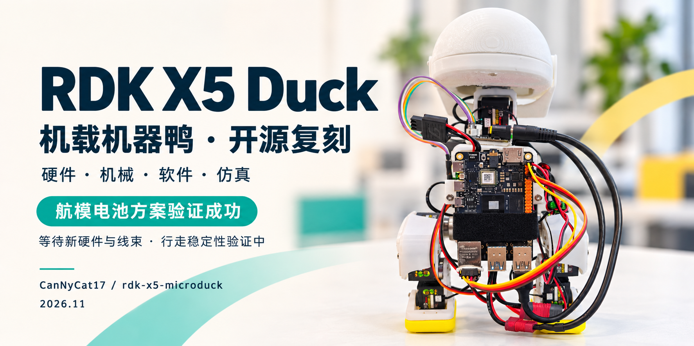

# 周苓萱 · CanNyCat

**机器人软件 · 端侧 AI · 嵌入式 Linux**

**重庆邮电大学 · 2028 届本科**｜集成电路设计与集成系统  
**地瓜机器人 · RDK 生态开发实习生**｜开发者生态部 · 2026.08–至今

关注机器人实机集成、端侧部署与开源交付。

[代表作品](#代表作品) · [竞赛与项目](#竞赛与项目) · [科研成果](#科研成果) · [技术与交流](#技术与交流)

## 代表作品

依托南京地瓜机器人生态开发部门

<table>
<tr>
<th width="50%" align="left"><a href="https://github.com/CanNyCat17/rdk-x5-microduck">RDK X5 Duck</a> · <a href="https://github.com/CanNyCat17/rdk-x5-microduck/stargazers">★ 36</a> 机器人集成与开源复刻</th>
<th width="50%" align="left"><a href="https://github.com/CanNyCat17/roboto-origin-rdk-s600">RDK S600</a> 多模态感知与实机部署</th>
</tr>
<tr>
<td width="50%" valign="top"></td>
<td width="50%" valign="top"></td>
</tr>
<tr>
<td width="50%" valign="top">

<strong>职责</strong> · Duck 项目主要负责人

<strong>成果</strong> · 15 轴整机集成、双电池全机载短距离前进；交付 <strong>24 章复刻手册</strong>。

稳定行走与 RL 实机闭环待验证。

<a href="https://github.com/CanNyCat17/rdk-x5-microduck/tree/main/software">源码</a> · <a href="https://github.com/CanNyCat17/rdk-x5-microduck/blob/main/docs/FULL_SOLUTION.md">手册</a> · <a href="https://github.com/CanNyCat17/rdk-x5-microduck/blob/main/media/20261023/onboard-short-walk.mp4">视频</a>

贡献与验证详情

<strong>控制与联调：</strong>Linux/Python 控制、舵机总线与 IMU 联调，开发 Web 调参、安全复位及分阶段颈部控制。

<strong>复刻支持：</strong>机械资料与 MuJoCo 教学仿真，配套<a href="https://forum.d-robotics.cc/t/topic/35728/1">地瓜社区教程</a>。

<strong>验证条件：</strong>短距离成果采用目标序列与颈部时序控制；后续航模电池＋5V UBEC 供电方案已验证。<a href="https://github.com/CanNyCat17/rdk-x5-microduck/blob/main/docs/CURRENT_PROTOTYPE.md">最新进度与验证记录</a>

<strong>项目来源：</strong>基于 <a href="https://github.com/pollen-robotics/microduck">Pollen Robotics MicroDuck</a> 与<a href="https://github.com/fanhao375/microduck-replica-cad">社区飞特结构</a>。

</td>
<td width="50%" valign="top">

<strong>职责</strong> · Roboto Origin 的 S600 实机部署

<strong>成果</strong> · YOLO 分割、Qwen3-VL 图片问答与 Whisper 转写；两分钟相机分割约 <strong>19.2 FPS</strong>。

自主导航与整机运动闭环待验收。

<a href="https://github.com/CanNyCat17/roboto-origin-rdk-s600/tree/main/apps/s600_coprocessor">源码</a> · <a href="https://github.com/CanNyCat17/roboto-origin-rdk-s600/blob/main/docs/S600_COPROCESSOR_DEMO.md">验证报告</a>

贡献与验证详情

<strong>我的贡献：</strong>负责算法适配与板端部署，联调相机、雷达、麦克风，完成 ONNX 数值校验、S600 BPU 推理及 X5/S100 离线适配。

<strong>验证条件：</strong>真实传感器输入下完成多模态演示；19.2 FPS 为两分钟相机分割测量结果，不代表整套多模态系统吞吐率。

</td>
</tr>
</table>

## 开发者生态贡献

- **课程交付 · 已完成**  
  交付所负责的 RDK X5/S100 双语课程、课件与实板样例。[课程贡献](https://github.com/D-Robotics/rdk-course-demos/commit/0ce864e93e8eaed061cebff69023e732961ea03e)
- **社区支持 · 持续开展**  
  诊断 SDK、BPU、相机及系统问题，跟进反馈并协同研发。[社区答复](https://forum.d-robotics.cc/u/cannycat/activity/replies)

<table>
<thead>
<tr>
<th width="50%" align="left"><h2>竞赛与项目</h2></th>
<th width="50%" align="left"><h2>科研成果</h2></th>
</tr>
</thead>
<tbody>
<tr>
<td width="50%" valign="top">

<strong>工程竞赛全国奖 4 项</strong>：一等奖 1 项、二等奖 2 项、三等奖 1 项。

<a href="https://github.com/CanNyCat17/memory-ate-pat-platform">2026 全国大学生集成电路创新创业大赛</a> · <strong>全国总决赛一等奖</strong>

<a href="https://github.com/CanNyCat17/dual-rdk-x5-materials-ai-robot-lab">2026 全国大学生嵌入式芯片与系统设计竞赛</a> · <strong>全国总决赛二等奖</strong>

<a href="https://github.com/CanNyCat17/Lab-Sentinel-CIMC2026">2026 CIMC“西门子杯”中国智能制造挑战赛</a> · <strong>全国总决赛二等奖</strong>

<a href="https://github.com/CanNyCat17/intelligent-vision-logistics-crane-2026">2026 中国大学生机械工程创新创意大赛物流技术创意赛</a> · <strong>全国总决赛三等奖</strong>

<a href="https://github.com/CanNyCat17/RootScope-AdventureX2026">AdventureX 2026 黑客松</a> · <strong>地瓜机器人赛道二等奖（第 2 名）· superun.ai 赛道三等奖</strong>

<a href="https://github.com/CanNyCat17/mcm-2026-b-lunar-logistics">2026 美国大学生数学建模竞赛（MCM）</a> · <strong>M 奖（Meritorious Winner）</strong>

<a href="https://github.com/CanNyCat17/sasando-digital-resonator">2025 国际大学生物理竞赛（University Physics Competition）</a> · <strong>金奖（Gold Medal）</strong>

<a href="https://github.com/CanNyCat17/bionic-butterfly-stm32">第十二届全国大学生机械创新设计大赛</a> · <strong>重庆赛区二等奖（省级）</strong>

赛事全名与个人贡献

前五项项目中担任 4 项队长，集创赛担任软件与 PAT 算法负责人。

- **[存储芯片 ATE/PAT 平台](https://github.com/CanNyCat17/memory-ate-pat-platform)**  
  2026 全国大学生集成电路创新创业大赛 · **全国总决赛一等奖** 
  软件与 PAT 算法负责人 · I²C/SPI 向量算法与 Electron 流式生成平台。

- **[双 RDK X5 材料 AI 与具身实验助理](https://github.com/CanNyCat17/dual-rdk-x5-materials-ai-robot-lab)**  
  2026 全国大学生嵌入式芯片与系统设计竞赛 · **全国总决赛二等奖** 
  队长 · 材料分析、CPU/BPU 部署与 ROS 2 多机双臂软件联调。

- **[Lab-Sentinel｜烧结安全哨兵](https://github.com/CanNyCat17/Lab-Sentinel-CIMC2026)**  
  2026 CIMC“西门子杯”中国智能制造挑战赛 · **全国总决赛二等奖** 
  队长 · GD32H759、FreeRTOS/LVGL 软件与 MCU 边缘推理优化。

- **[自主散料搬运机器人](https://github.com/CanNyCat17/intelligent-vision-logistics-crane-2026)**  
  2026 中国大学生机械工程创新创意大赛物流技术创意赛 · **全国总决赛三等奖** 
  队长 · Jetson 视觉、ROS 2 导航及串口联调。

- **[RootScope｜根区灌溉舱](https://github.com/CanNyCat17/RootScope-AdventureX2026)**  
  AdventureX 2026 黑客松 · **地瓜机器人赛道二等奖（第 2 名）· superun.ai 赛道三等奖** 
  队长 · 视觉模型与 X5→STM32 探针/水泵联调。

- **[美国大学生数学建模竞赛｜月球殖民地运输规划](https://github.com/CanNyCat17/mcm-2026-b-lunar-logistics)** 
  2026 Mathematical Contest in Modeling（MCM）· **M 奖（Meritorious Winner）** 
  B 题 · 多目标运输优化、蒙特卡洛可靠性分析。[论文](https://github.com/CanNyCat17/mcm-2026-b-lunar-logistics/blob/main/paper/2600039.pdf) · [源码](https://github.com/CanNyCat17/mcm-2026-b-lunar-logistics/tree/main/matlab)

- **[国际大学生物理竞赛｜Sasando 数字谐振器](https://github.com/CanNyCat17/sasando-digital-resonator)** 
  2025 University Physics Competition · **金奖（Gold Medal）** 
  项目负责人 · Problem A / Team 112。[论文](https://www.uphysicsc.com/2025-GM-A-112.pdf) · [源码](https://github.com/CanNyCat17/sasando-digital-resonator)

- **[仿生蝴蝶｜四电机协同控制](https://github.com/CanNyCat17/bionic-butterfly-stm32)** 
  第十二届全国大学生机械创新设计大赛 · **重庆赛区二等奖（省级）** 
  开源实现 · STM32G031 + DRV8837 四电机 PWM 驱动、镜像极性修正与协同动作；当前为电机调试阶段，扑翅与飞行未验证。

目录依据：嵌入式芯片与系统设计竞赛、“西门子杯”、集创赛、中国大学生机械工程创新创意大赛及机械创新设计大赛均列入《<a href="https://statics.scnu.edu.cn/pics/xsb/2025/0103/1735893141731811.pdf">2024 全国普通高校大学生竞赛分析报告</a>》竞赛目录；物流技术创意赛为机械工程创新创意大赛的<a href="https://www.cmes.org/notice/010c5f85554e440e99d702008b58a26f.html">专项赛</a>。项目标题可点击查看源码与成果。

</td>
<td width="50%" valign="top">

<strong>SCI/SCIE 论文 2 篇 · 均为共同作者</strong>

<a href="https://doi.org/10.1016/j.ceramint.2025.10.342">Ceramics International</a> · <strong>Q1</strong> 
<a href="https://doi.org/10.1016/j.jlumin.2025.121192">Journal of Luminescence</a> · <strong>Q2</strong>（JCR 2024）

<strong>重庆市级大学生创新训练项目</strong> 
第一负责人 · 2026 年 
Cr³⁺ 近红外荧光材料设计与应用

论文题名与科研职责

1. [Enhanced luminescence performance of near-infrared phosphor Y₂CaAl₄SiO₁₂: Fe³⁺, Yb³⁺ through energy transfer for anti-counterfeiting applications](https://doi.org/10.1016/j.ceramint.2025.10.342). *Ceramics International*, **51** (2025), 61520–61530.
2. [Exploring the luminescence mechanism and enabling tunable emission in Sr₃YGa₂O₇.₅: Bi³⁺, Eu³⁺ phosphors for advanced UV-converted white LEDs](https://doi.org/10.1016/j.jlumin.2025.121192). *Journal of Luminescence*, **281** (2025), 121192.

- **重庆市级大学生创新训练项目｜高效 Cr³⁺掺杂宽带近红外光源的设计及应用研究**（2026 年）：第一负责人，负责项目统筹与材料高通量筛选；研究结构限域、邻位调控与能量传递，面向近红外荧光粉及 LED 器件应用。

</td>
</tr>
</tbody>
</table>

## 技术与交流

**机器人集成**　Linux/Python · 舵机总线与 IMU 联调 · Web 调参与复位 · MuJoCo 仿真  
**端侧部署**　PyTorch/ONNX · 数值校验 · RDK CPU/BPU · 视觉、图文与语音模型  
**嵌入开发**　C/C++ · STM32/GD32 · FreeRTOS/LVGL · UART/I²C/SPI/CAN  
**机器人应用**　ROS 2 · Jetson 视觉与导航联调 · 多机协同

**合作与实习**  
项目共建：欢迎机械、硬件电控及运动控制伙伴。  
实习方向：嵌入式 Linux · 端侧 AI 部署 · 机器人软件。

**[3773318175@qq.com](mailto:3773318175@qq.com)** · 邮件索取最新版简历 · 项目问题请提交对应仓库 Issue。

更新于 2026-11-09 · 星数截至更新日，实时数量见仓库 · 实机阶段与验证范围详见各项目仓库。
