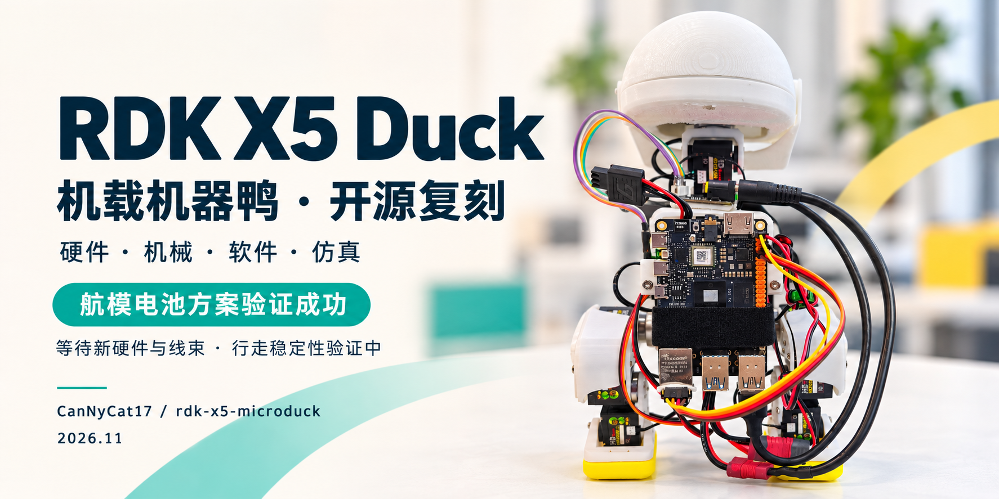
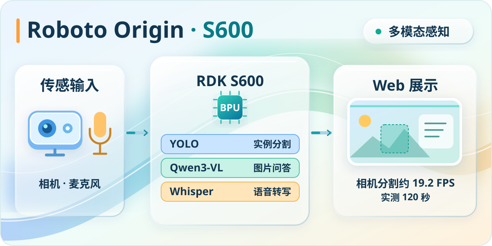

# 周苓萱 · CanNyCat

**机器人软件 · 端侧 AI · 嵌入式 Linux**

**重庆邮电大学 · 2028 届本科**｜集成电路设计与集成系统  
**地瓜机器人 · RDK 生态开发实习生**｜开发者生态部 · 2026.08–至今

关注机器人实机集成、端侧部署与开源交付。

[代表作品](#代表作品) · [竞赛与项目](#竞赛与项目) · [科研成果](#科研成果) · [技术与交流](#技术与交流)

## 代表作品

Duck、Roboto Origin 与开发者生态工作依托南京地瓜机器人生态开发部门开展。

<table>
<tr>
<th width="50%" align="left"><a href="https://github.com/CanNyCat17/rdk-x5-microduck">RDK X5 Duck</a> · <a href="https://github.com/CanNyCat17/rdk-x5-microduck/stargazers">★ 59</a> 机器人集成与开源复刻</th>
<th width="50%" align="left"><a href="https://github.com/CanNyCat17/hbot-s600-deployment">地平线 H-Bot 机甲巅峰赛</a> RDK S600 机器人策略部署</th>
</tr>
<tr>
<td width="50%" valign="top"></td>
<td width="50%" valign="top"></td>
</tr>
<tr>
<td width="50%" valign="top">

<strong>职责</strong> · Duck 项目主要负责人

<strong>成果</strong> · 15 轴整机集成、双电池全机载短距离前进；交付 <strong>24 章复刻手册</strong>。

稳定行走与 RL 实机闭环待验证。

<a href="https://github.com/CanNyCat17/rdk-x5-microduck/tree/main/software">源码</a> · <a href="https://github.com/CanNyCat17/rdk-x5-microduck/blob/main/docs/FULL_SOLUTION.md">手册</a> · <a href="https://github.com/CanNyCat17/rdk-x5-microduck/blob/main/media/20261023/onboard-short-walk.mp4">视频</a>

贡献与验证详情

<strong>控制与联调：</strong>Linux/Python 控制、舵机总线与 IMU 联调，开发 Web 调参、安全复位及分阶段颈部控制。

<strong>复刻支持：</strong>机械资料与 MuJoCo 教学仿真，配套<a href="https://forum.d-robotics.cc/t/topic/35728/1">地瓜社区教程</a>。

<strong>验证条件：</strong>短距离成果采用目标序列与颈部时序控制；后续航模电池＋5V UBEC 供电方案已验证。<a href="https://github.com/CanNyCat17/rdk-x5-microduck/blob/main/docs/CURRENT_PROTOTYPE.md">最新进度与验证记录</a>

<strong>项目来源：</strong>基于 <a href="https://github.com/pollen-robotics/microduck">Pollen Robotics MicroDuck</a> 与<a href="https://github.com/fanhao375/microduck-replica-cad">社区飞特结构</a>。

</td>
<td width="50%" valign="top">

<strong>职责</strong> · 板端部署与推理优化

<strong>成果</strong> · 在 RDK S600 上完成 LeRobot π0.5 单帧 SDK 离线推理，得到 <strong>50 步 × 8 维</strong>动作序列。

<a href="https://github.com/CanNyCat17/hbot-s600-deployment">部署代码与验证说明</a> · <a href="https://hbot-competition.horizon.auto/">赛事官网</a>

贡献与验证详情

公开了去噪速度场采集工具，以及使用合成动作块检查前缀选择、逐步确认和历史隔离的辅助代码。

当前公开结果为单帧离线验证，板端稳定性与闭环评测待验收。

</td>
</tr>
<tr>
<th width="50%" align="left"><a href="https://github.com/CanNyCat17/roboto-origin-rdk-s600">Roboto Origin · RDK S600</a> 多模态感知与实机部署</th>
<th width="50%" align="left">开发者生态贡献 课程交付与社区支持</th>
</tr>
<tr>
<td width="50%" valign="top">

<strong>职责</strong> · Roboto Origin 的 S600 实机部署

<strong>成果</strong> · YOLO 相机分割实测 120 秒，约 <strong>19.2&nbsp;FPS</strong>。在 S600 BPU 上完成 Qwen3-VL 图片问答与 Whisper 语音转写。

自主导航与整机运动闭环待验收。

<a href="https://github.com/CanNyCat17/roboto-origin-rdk-s600/blob/main/docs/S600_COPROCESSOR_DEMO.md">验证报告</a> · <a href="https://github.com/CanNyCat17/roboto-origin-rdk-s600/tree/main/apps/s600_coprocessor">源码</a>

贡献与验证详情

<strong>我的贡献：</strong>负责算法适配与板端部署，联调相机、雷达、麦克风，完成 ONNX 数值校验、S600 BPU 推理及 X5/S100 离线适配。

<strong>运行方式：</strong>相机分割在后台持续运行。Qwen3-VL 与 Whisper 共享 BPU 资源，图片问答和语音转写请求依次处理。

</td>
<td width="50%" valign="top">

<strong>课程交付 · 已完成</strong> 交付所负责的 RDK X5/S100 双语课程、课件与实板样例。 <a href="https://github.com/D-Robotics/rdk-course-demos/commit/0ce864e93e8eaed061cebff69023e732961ea03e">课程贡献</a>

<strong>社区支持 · 持续开展</strong> 诊断 SDK、BPU、相机及系统问题，跟进反馈并协同研发。 <a href="https://forum.d-robotics.cc/u/cannycat/activity/replies">社区答复</a>

</td>
</tr>
</table>

<table>
<thead>
<tr>
<th width="70%" align="left"><h2>竞赛与项目</h2></th>
<th width="30%" align="left"><h2>科研成果</h2></th>
</tr>
</thead>
<tbody>
<tr>
<td width="70%" valign="top">

<strong>工程竞赛全国奖 4 项</strong>：一等奖 1 项、二等奖 2 项、三等奖 1 项。

<a href="https://github.com/CanNyCat17/memory-ate-pat-platform">2026 全国大学生集成电路创新创业大赛</a> · <strong>全国总决赛一等奖</strong>｜成员

<a href="https://github.com/CanNyCat17/dual-rdk-x5-materials-ai-robot-lab">2026 全国大学生嵌入式芯片与系统设计竞赛</a> · <strong>全国总决赛二等奖</strong>｜队长

<a href="https://github.com/CanNyCat17/Lab-Sentinel-CIMC2026">2026 CIMC“西门子杯”中国智能制造挑战赛</a> · <strong>全国总决赛二等奖</strong>｜队长

<a href="https://github.com/CanNyCat17/intelligent-vision-logistics-crane-2026">2026 中国大学生机械工程创新创意大赛物流技术创意赛</a> · <strong>全国总决赛三等奖</strong>｜队长

<a href="https://github.com/CanNyCat17/RootScope-AdventureX2026">2026 AdventureX 黑客松</a> · <strong>地瓜机器人赛道二等奖</strong>｜队长

<a href="https://github.com/CanNyCat17/bionic-butterfly-stm32">2026 全国大学生机械创新设计大赛</a> · <strong>重庆赛区二等奖</strong>

<a href="https://github.com/CanNyCat17/mcm-2026-b-lunar-logistics">2026 Mathematical Contest in Modeling</a> · <strong>Meritorious Winner</strong>

<a href="https://github.com/CanNyCat17/sasando-digital-resonator">2025 University Physics Competition</a> · <strong>Gold Medal</strong>

项目职责与成果

- **[存储芯片 ATE/PAT 平台](https://github.com/CanNyCat17/memory-ate-pat-platform)**  
  担任软件与 PAT 算法负责人，开发 I²C/SPI 测试向量算法与 Electron 流式生成平台。23LC1024 全容量回归生成 **563 万余行测试向量**。

- **[双 RDK X5 材料 AI 与具身实验助理](https://github.com/CanNyCat17/dual-rdk-x5-materials-ai-robot-lab)**  
  负责 XRD/PL 材料分析与机器人软件。针对内存约束采用 CPU/BPU 分层与按需换模，完成 INT8 真板推理及 ROS 2 多机双臂联调。

- **[Lab-Sentinel｜烧结安全哨兵](https://github.com/CanNyCat17/Lab-Sentinel-CIMC2026)**  
  负责 GD32H759 上的 FreeRTOS/LVGL 软件开发与 MCU 端推理优化。

- **[自主散料搬运机器人](https://github.com/CanNyCat17/intelligent-vision-logistics-crane-2026)**  
  负责 Jetson 上位机视觉、ROS 2 导航及串口联调。

- **[RootScope｜根区灌溉舱](https://github.com/CanNyCat17/RootScope-AdventureX2026)**  
  负责视觉模型，联调 X5 与 STM32 控制的探针和水泵。地瓜机器人赛道第 2 名，另获 superun.ai 赛道三等奖。

- **[仿生蝴蝶｜四电机协同控制](https://github.com/CanNyCat17/bionic-butterfly-stm32)** 
  开源 STM32G031 + DRV8837 四电机 PWM 驱动、镜像极性修正与协同动作代码。当前代码用于电机调试，扑翅与飞行仍待验证。

- **[月球殖民地运输规划](https://github.com/CanNyCat17/mcm-2026-b-lunar-logistics)** 
  B 题，比较太空电梯与火箭的运输方案，进行多目标优化和蒙特卡洛可靠性分析。[完整论文](https://github.com/CanNyCat17/mcm-2026-b-lunar-logistics/blob/main/paper/2600039.pdf) · [MATLAB 源码](https://github.com/CanNyCat17/mcm-2026-b-lunar-logistics/tree/main/matlab)

- **[Sasando 数字谐振器](https://github.com/CanNyCat17/sasando-digital-resonator)** 
  项目负责人，Team 112 / Problem A。[官方金奖论文](https://www.uphysicsc.com/2025-GM-A-112.pdf) · [项目源码](https://github.com/CanNyCat17/sasando-digital-resonator)

目录依据：嵌入式芯片与系统设计竞赛、“西门子杯”、集创赛、中国大学生机械工程创新创意大赛及机械创新设计大赛均列入《<a href="https://statics.scnu.edu.cn/pics/xsb/2025/0103/1735893141731811.pdf">2024 全国普通高校大学生竞赛分析报告</a>》竞赛目录；物流技术创意赛为机械工程创新创意大赛的<a href="https://www.cmes.org/notice/010c5f85554e440e99d702008b58a26f.html">专项赛</a>。项目标题可点击查看源码与成果。

</td>
<td width="30%" valign="top">

<strong>SCI/SCIE Publications (2) · Co-author</strong> 
<a href="https://doi.org/10.1016/j.ceramint.2025.10.342">Ceramics International</a>&nbsp;<strong>Q1</strong> 
<a href="https://doi.org/10.1016/j.jlumin.2025.121192">Journal of Luminescence</a>&nbsp;<strong>Q2</strong> 
JCR 2024

<strong>2026 重庆市级大学生创新训练项目</strong>｜第一负责人

论文题名与科研职责

1. Yunlong Li, Dan Zhang, Taifang Zhang, **Lingxuan Zhou**, Peng Wang, Vesna Đorđević, Valery F. Gremenok, Miroslav D. Dramićanin, Chonggeng Ma. [Enhanced luminescence performance of near-infrared phosphor Y₂CaAl₄SiO₁₂: Fe³⁺, Yb³⁺ through energy transfer for anti-counterfeiting applications](https://doi.org/10.1016/j.ceramint.2025.10.342). *Ceramics International*, **51** (2025), 61520–61530.
2. Taifang Zhang, Dan Zhang, Peng Wang, **Lingxuan Zhou**, Mikhail G. Brik, Chonggeng Ma. [Exploring the luminescence mechanism and enabling tunable emission in Sr₃YGa₂O₇.₅: Bi³⁺, Eu³⁺ phosphors for advanced UV-converted white LEDs](https://doi.org/10.1016/j.jlumin.2025.121192). *Journal of Luminescence*, **281** (2025), 121192.

- **重庆市级大学生创新训练项目｜高效 Cr³⁺掺杂宽带近红外光源的设计及应用研究**（2026 年）：第一负责人，负责项目统筹与材料高通量筛选；研究结构限域、邻位调控与能量传递，面向近红外荧光粉及 LED 器件应用。

</td>
</tr>
</tbody>
</table>

## 技术与交流

**机器人集成**　Linux/Python · 舵机总线与 IMU 联调 · Web 调参与复位 · MuJoCo 仿真  
**端侧部署**　PyTorch/ONNX · 数值校验 · RDK CPU/BPU · 视觉、图文与语音模型  
**嵌入开发**　C/C++ · STM32/GD32 · FreeRTOS/LVGL · UART/I²C/SPI/CAN  
**机器人应用**　ROS 2 · Jetson 视觉与导航联调 · 多机协同

**合作与实习**  
项目共建：欢迎机械、硬件电控及运动控制伙伴。  
实习方向：嵌入式 Linux · 端侧 AI 部署 · 机器人软件。

**[3773318175@qq.com](mailto:3773318175@qq.com)** · 邮件索取最新版简历 · 项目问题请提交对应仓库 Issue。

更新于 2026-11-20 · 星数统计于 2026-11-19，实时数量见仓库 · 实机阶段与验证范围详见各项目仓库。
